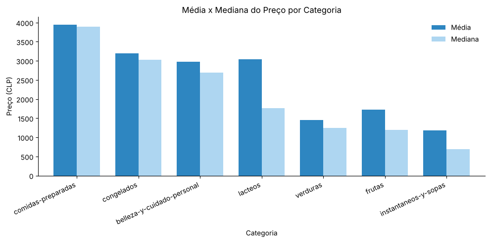
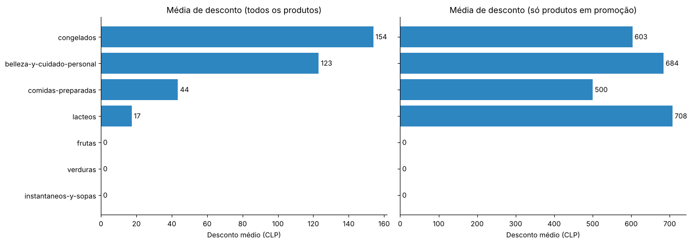

# Análise de preços de supermercado

Projeto do curso **Profissão: Cientista de Dados (EBAC)**, Módulo 13 – Fundamentos da Descoberta de Dados.

Análise estatística e visual de **1.107 produtos** de um supermercado chileno, com preços em pesos chilenos (CLP), para entender como os preços e as promoções se distribuem entre as categorias.

**Autor:** Lucas Farias Epitácio de Almeida

## O que foi feito

1. Média, mediana, desvio padrão e coeficiente de variação do preço por categoria.
2. Boxplot e identificação de outliers na categoria mais dispersa (lácteos).
3. Média de desconto por categoria, considerando todos os produtos e só os que estavam em promoção.
4. Treemap interativo de descontos por categoria e marca (Plotly).

## Tratamento dos dados

27% dos produtos (294) tinham `Preco_Normal = 0`. Não é preço zero: são produtos em promoção, cujo preço aparece em outra coluna. Esses zeros foram tratados antes dos cálculos para não puxar as médias para baixo.

## Principais achados

- **Todas as categorias têm preços assimétricos à direita:** a média fica acima da mediana em todas.
- **Lácteos é a categoria mais dispersa** (coeficiente de variação de 139%). A média é 1,7 vez a mediana por causa dos packs de 12 unidades, que aparecem como outliers no boxplot.
- **As promoções se concentram em congelados e cuidados pessoais**, com 25,5% e 18,0% dos produtos em promoção. Frutas, verduras e instantâneos não tinham nenhum desconto.
- **Quando há desconto, ele é de valor parecido entre as categorias** (de 500 a 708 CLP). O que muda é a frequência das promoções, não o tamanho delas.





O treemap interativo está em [`resultados/treemap_descontos.html`](resultados/treemap_descontos.html). O GitHub não exibe o gráfico na página, então baixe o arquivo e abra no navegador.

## Estrutura

```
├── Modulo13_Descoberta_de_Dados.ipynb   # notebook com código, gráficos e análises
├── base_supermercado.csv                # dados
├── resultados/                          # tabelas consolidadas (CSV) e treemap interativo (HTML)
├── imagens/                             # gráficos usados neste README
└── requirements.txt
```

## Como executar

```bash
pip install -r requirements.txt
jupyter notebook Modulo13_Descoberta_de_Dados.ipynb
```

**No Google Colab:** envie o `base_supermercado.csv` para o painel de arquivos, crie a pasta `resultados/` e execute todas as células.

## Tecnologias

Python · pandas · NumPy · Matplotlib · Plotly
